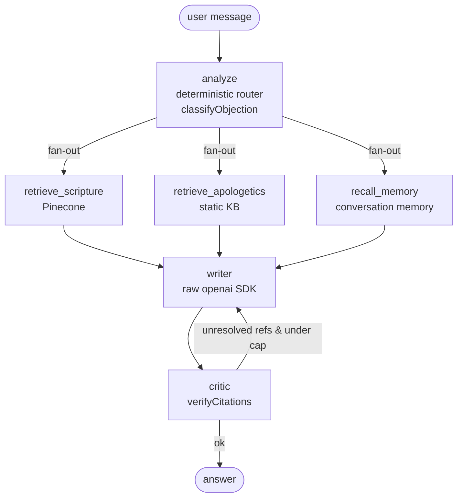
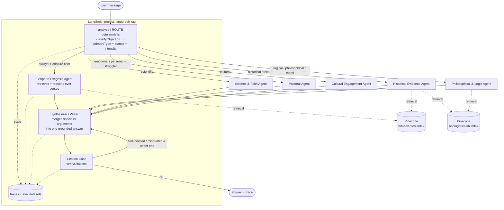
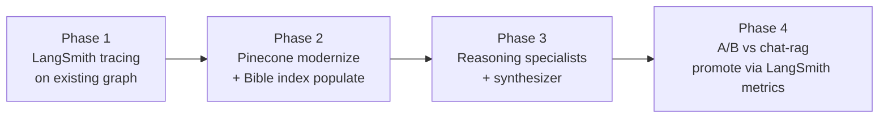

# Shield AI — Multi-Agent RAG Architecture (Living Doc)

> **Status:** Design / in progress
> **Last updated:** 2026-08-10
> **Owner:** Will
> **Scope:** Promote the experimental LangGraph apologetics pipeline to a traced,
> modern, production-grade multi-agent RAG system with a deterministic router,
> smarter reasoning specialists, LangSmith observability, and a populated Bible
> vector index.

This is a **living reference doc**. We update it as we build. Every section has a
status tag: `✅ done` · `🚧 in progress` · `📋 planned` · `❓ open question`.

---

## 1. Decisions locked (2026-08-10)

| # | Decision | Rationale |
|---|---|---|
| 1 | **Router stays deterministic** (`classifyObjection`, rules-based) | Objection taxonomy is stable; a rules router is cheaper, faster, and more reliable than an LLM supervisor. Invest in specialists, not routing. |
| 2 | **Specialists become reasoning agents** behind the rules router | The current graph's "specialists" are thin retrieval fetchers. Upgrade them to persona/reasoning agents mapped to the objection taxonomy. |
| 3 | **Wire LangSmith** into the existing graph | Biggest gap today: we pay for LangSmith and get nothing. This is the observability layer for everything else. |
| 4 | **Modernize the stack** | Pinecone SDK `1.1.3` is ancient; embedding dimension-reduction is a lossy hack; `langsmith`/`@langchain/openai` not installed. |
| 5 | **Bible index is greenfield** | Not populated today. Populate it correctly from the start (native embedding dims, clean namespaces). |

---

## 2. Current state (what already exists)

We are **not** greenfield. ~80% of the multi-agent pipeline is already written and
wired — it's experimental and un-traced.

### 2.1 Chat routes (ascending sophistication)

| Route | File | What it is | Status |
|---|---|---|---|
| `chat` | `pages/api/chat.ts` | 817-line monolith, eager Wave-1/Wave-2 retrieval | prod fallback |
| `chat-rag` | `pages/api/chat-rag.ts` | RAG retrieval + generate | **live prod path** |
| `chat-agentic` | `pages/api/chat-agentic.ts` | Bounded OpenAI tool-loop + "Scripture floor" | experimental |
| `chat-graph` | `pages/api/chat-graph.ts` → `lib/graph/apologetics-graph.ts` | **LangGraph `StateGraph`**: router → parallel specialists → writer → citation critic w/ reflection loop | experimental, wired, opt-in |

Production traffic today: `chatService.ts` calls `/api/chat-rag`, falls back to `/api/chat`.
The graph is reached only via `?graph=1` / `x-shield-graph: 1` / `{ graph: true }`.

### 2.2 The existing graph (`apologetics-graph.ts`)



Key facts:
- **Router is deterministic** — `classifyObjection` decides the fan-out. No model call to route.
- **Specialists are retrieval-only** — they fetch, they don't reason. ← *this is what we upgrade.*
- **Writer uses raw `openai` SDK**, not `@langchain/openai` — deliberate, to avoid a stale dep. ← *this is why LangSmith sees nothing.*
- **Critic already produces eval-grade data**: `hallucinated`, `misquoted`, `checked`. ← *free eval metric.*
- **Reflection loop** capped at `GRAPH_MAX_CORRECTIONS` (default 1).

### 2.3 RAG / vector layer

| Piece | File | Notes |
|---|---|---|
| Embeddings | `lib/embeddings.ts` | `text-embedding-3-small`; ⚠️ hand-rolled 1536→1024 weighted-average reduction (lossy) |
| Bible index service | `lib/bible-pinecone.ts` | `bulkImportBible`, `searchBibleContent`, per-book/chapter namespaces |
| Bible import route | `pages/api/pinecone/bible-import.ts` | Pulls from Bible API (`BIBLE_API_KEY`), embeds, upserts |
| General Pinecone | `lib/pinecone.ts` | Per-user namespaces; SDK `@pinecone-database/pinecone@1.1.3` (⚠️ ancient) |
| Apologetics KB | `lib/apologetics-knowledge.ts` | **Static in-code array**, ~6 entries. Not vectorized. |

### 2.4 Installed AI deps

```
@langchain/core       ^1.2.4     ✅ modern (v1)
@langchain/langgraph  ^1.4.9     ✅ modern (v1)
@pinecone-database/pinecone ^1.1.3   ⚠️ ancient (current major is v6+)
openai                ^4.20.1    ⚠️ old within v4
langsmith             (absent)   ❌ needed for tracing
@langchain/openai     (absent)   ❌ optional, for first-class LLM tracing
```

---

## 3. Target architecture

Same deterministic router. Retrieval fetchers → **reasoning specialist agents**.
A synthesizer merges specialist arguments; the citation critic stays. Everything
traced in LangSmith.



### 3.1 Specialist roster (maps to the existing taxonomy)

The router already emits `primaryType` (8 values), `userStance` (5), `intensity`
(3), `responseStrategy` (5). We map those to a **small set of reasoning agents** —
not 8, to keep fan-out cheap. Scripture Exegesis is the always-on floor.

| Specialist | Fires when `primaryType` ∈ | Tools / retrieval | Persona |
|---|---|---|---|
| **Scripture Exegesis** (floor) | *always* | Bible Pinecone index, cross-refs | Exegete: grounds every claim in retrieved verses, cites explicitly |
| **Historical Evidence** | `historical` | Apologetics KB index (resurrection, reliability) | Historian: manuscripts, dating, extra-biblical sources |
| **Philosophical & Logic** | `logical`, `philosophical`, `moral` | Apologetics KB (moral argument, theodicy) | Analytic philosopher: argument structure, problem of evil |
| **Science & Faith** | `scientific` | Apologetics KB (science-faith) | "How vs. why"; fine-tuning; non-overlapping domains |
| **Pastoral** | `emotional`, `personal` (esp. stance `struggler`) | Conversation memory | Gentle, empathetic, minimal argumentation |
| **Cultural Engagement** | `cultural` | Apologetics KB (engagement) | Modern-relevance framing |

> The router picks **Scripture Exegesis + the 1 (or 2, using `secondaryType`)
> specialist(s) matching the objection.** Keeps the fan-out to 2–3 agents/turn.

`responseStrategy` and `intensity` tune the **synthesizer's tone**, not which
agents fire (e.g. `pastoral` strategy softens the merge even for a `historical`
objection from a `struggler`).

### 3.2 What changes vs. today

| Aspect | Today | Target |
|---|---|---|
| Router | deterministic ✅ | deterministic ✅ (unchanged) |
| Specialist nodes | retrieval fetchers | reasoning agents (own prompt + tools) |
| Merge step | writer sees raw evidence dump | synthesizer merges specialist *arguments* |
| Critic | citation verify ✅ | unchanged |
| Observability | none | LangSmith traces + eval datasets |
| Apologetics KB | static in-code array | vectorized Pinecone index |
| Bible index | empty | populated w/ native-dim embeddings |

---

## 4. LangSmith integration — Phase 1 `✅ tracing live in production`

**Tracing is DONE and VERIFIED in production (2026-08-11)** — traces flowing in
project **`langgraph-rag`**. Shipped via PR #25 (merge commit `1301896`).
Remaining Phase-1 item: the citation eval dataset (§4.1).

What's wired (2026-08-10):
- `langsmith@0.8.9` installed in `@shieldai/web`.
- New shared client: **`lib/observability/openai-traced.ts`** — `getTracedOpenAI()`
  returns a singleton wrapped with `wrapOpenAI` **only when tracing is enabled**
  (transparent passthrough otherwise, so no behavior change when off).
- Routed through it: **`apologetics-graph.ts`** (writer), **`embeddings.ts`**
  (scripture-retrieval embedding calls), **`chat-agentic.ts`**.
- Env-driven toggle (see `src/config/env.example`):
  ```
  LANGSMITH_TRACING=true
  LANGSMITH_API_KEY=ls__...
  LANGSMITH_PROJECT=langgraph-rag   # defaulted in code if unset
  ```
- LangGraph nodes auto-trace; wrapped LLM/embedding calls appear as nested spans.
  **No architecture change.** Verified: client is usable with tracing on and off.

**Still to do in Phase 1:**
- ❗ **You** set `LANGSMITH_API_KEY` + `LANGSMITH_TRACING=true` in Vercel (and local
  `.env.local`) — I can't do this (needs your key).
- Run one graph turn (`/api/chat?graph=1`) and confirm the trace lands in the
  `langgraph-rag` project.
- Build the citation eval dataset (§4.1).

**Full-surface tracing (2026-08-10):** every real OpenAI call site now goes
through `getTracedOpenAI()` — `chat.ts`, `chat-rag.ts`, `vector-response.ts`,
`bible/ai-insights.ts`, `bible/cross-references.ts`, `bible/study-questions.ts`,
and `lib/image-generation.ts` (DALL·E). The six identical API-route singletons
dropped their `import OpenAI` (it was only the singleton's type); `image-generation.ts`
keeps `import type OpenAI` for its method signature. Only exclusion:
`chat-enhanced.ts.backup` (dead, not a route). So with tracing on, prod traffic
(`chat-rag`) and all Bible AI features appear in `langgraph-rag`, not just the graph.

**Option B (fuller):** swap writer/specialists to `ChatOpenAI` from
`@langchain/openai` — deferred to Phase 3 when we build the reasoning specialists.

**Option B — fuller:** swap the writer/specialists to `ChatOpenAI` from
`@langchain/openai` (matching `@langchain/core@1`) for first-class tracing + eval
hooks. Do this when we build the reasoning specialists (Section 6, Phase 3).

### 4.1 Evals we get almost for free
The critic already computes citation correctness. Turn per-turn results into a
LangSmith **dataset + evaluator**:
- **Citation faithfulness** — `hallucinated == 0 && misquoted == 0`
- **Scripture-floor honored** — theological objection ⇒ ≥1 real verse cited
- **Latency / rounds** — per-node timing, correction-loop count

> ❓ **Open:** Do we also want an LLM-judge evaluator for answer *quality*
> (persuasiveness, tone-match to `mode`), or start with the deterministic
> citation metrics only?

---

## 5. Pinecone + Bible vectorization `📋 planned`

### 5.0 CRITICAL FINDING — the existing `shieldai` index is misconfigured for how the app uses it (2026-08-10)

Read off the console + verified in code:

**`shieldai` index:** 1024-dim, cosine, region `aws/us-east-1`, host
`shieldai-smb4qh6.svc.aped-4627-b74a...`, **integrated embedding model
`llama-text-embed-v2`** (NVIDIA-hosted, dense, 1024, field map → `text`),
on-demand capacity. **98 records total.**

**The mismatch:** every RAG file (`bible-pinecone.ts`, `pinecone.ts`,
`pinecone-direct.ts`, `insights-pinecone.ts`) writes/reads via the **raw vectors
API** (`/vectors/upsert` with `values`, `/query` with a query vector), feeding
**OpenAI `text-embedding-3-small` embeddings down-averaged 1536→1024**. **None**
use the integrated records API (`/records/upsert` + `/records/search` with text).
⇒ The index's `llama-text-embed-v2` model is **completely bypassed**. The index
stores OpenAI-space vectors under a config that claims a different model.

**Consequences:**
- The app's own read path is *self-consistent* (query uses the same OpenAI-averaged
  path), so memory recall "works" — but in a degraded averaged space, and you
  **cannot** use Pinecone's integrated text search (`/records/search`) against
  these vectors (it would embed the query with llama and compare to OpenAI space = garbage).
- If any records were written via the console/integrated model, the space is
  **mixed/polluted**.

**Namespaces (98 records):** per-user memory (`ec74002e…`=72, UUID namespaces 4/2,
`__default__`=16) + test leftovers (`test-user-123`=3, `test-user`=1) + insights
namespaces (empty). **No Bible verses.** ⇒ Bible is greenfield, but this index is
the wrong foundation — don't pile Bible data on top of the OpenAI/llama confusion.
> ❓ Cleanup: the `test-user*` namespaces look like leftover test data — safe to delete.

### 5.1 The embedding decision (now well-informed)
Two clean architectures for a **new, dedicated Bible index** (leave `shieldai`
alone for memory/insights):

**Option A — Integrated `llama-text-embed-v2` (RECOMMENDED).** New index embedded
by Pinecone. Upsert verse **text** (`/records/upsert`); query with **text**
(`/records/search`). Pinecone embeds both sides with the same model.
- ✅ Kills the 1536→1024 averaging hack entirely (no client embeddings for Bible).
- ✅ Removes the OpenAI embedding round-trip from every scripture retrieval (faster, cheaper — $0.16/1M tokens).
- ✅ One consistent space; matches the Pinecone MCP/skills tooling (integrated-index-oriented).
- ⚠️ Scripture retrieval node switches from `EmbeddingService`+`/query` to `/records/search`.
- ⚠️ Two models in the system (llama for Bible, OpenAI elsewhere) — fine; separate indexes.

**Option B — Bring-your-own OpenAI, native dims.** New **standard** index at
native OpenAI dims (**1536**, cosine), keep client embeddings but fix the hack
(`dimensions: 1536` — no averaging).
- ✅ Full model control; consistent with the app's OpenAI usage elsewhere.
- ⚠️ Keeps embedding cost/latency in the retrieval path.

> **DECISION ✅ (2026-08-10): Option A — integrated `llama-text-embed-v2`.**
> New dedicated index, text-in/text-out via the records API. No client embeddings
> for Bible; the 1536→1024 averaging hack is not on the Bible path at all.
> `EmbeddingService` stays only for the legacy `shieldai` memory/insights index.

### 5.2 Index design (assuming Option A)
| Index | Content | Model / Dim | Namespaces |
|---|---|---|---|
| `bible-verses` (new) | Every verse from Bible API | integrated `llama-text-embed-v2` / 1024 | by translation/version id |
| `apologetics-kb` (new) | The static KB, expanded | integrated `llama-text-embed-v2` / 1024 | by category |
| `shieldai` (existing) | Memory + insights (leave as-is for now) | OpenAI-averaged 1024 | per-user UUID |

- **Source:** Bible API (`BIBLE_API_KEY`), already integrated in `bible-pinecone.ts`.
- **Record fields (integrated):** `text` (embedded) + metadata `reference`, `book`,
  `chapter`, `verse`, `version`.
- **Chunking:** verse-level for citation precision; consider a parallel
  pericope-level chunk for thematic recall. ❓ open.

### 5.3 SDK modernization — *smaller than it looked*
**Finding (2026-08-10):** the `@pinecone-database/pinecone` SDK is imported in
**exactly one** place — `pages/api/pinecone/indexes.ts` (an admin utility route).
**All data-plane RAG is hand-rolled REST** against `https://api.pinecone.io/indexes`
(control plane, to resolve the index host) + `https://{host}/{query,upsert,describe_index_stats}`
(data plane), across `bible-pinecone.ts`, `insights-pinecone.ts`, `pinecone-direct.ts`,
`pinecone.ts`. The REST calls use a plain `Api-Key` header and are version-proof.

So "bump the SDK" is nearly a no-op for the hot path. The real decision:
- **Option 1 (leaning):** keep the REST data plane (robust, dependency-light,
  already works with serverless indexes), and either upgrade **or delete** the
  barely-used SDK (rewrite the one admin route in REST too, then drop the dep).
- **Option 2:** standardize everything on the **v6 SDK** — more idiomatic, typed,
  but a larger rewrite of 4 files for marginal benefit over working REST.

> The v1.1.3 SDK can't even init against a serverless index without the legacy
> `environment` field — which is why the app went REST in the first place.

**Also (2026-08-10):** local `src/apps/web/.env.local` has an **invalid/stale**
`PINECONE_API_KEY` (401) and a too-short `OPENAI_API_KEY` — the real keys live in
Vercel. Local dev can't exercise RAG until `.env.local` is refreshed. Not blocking
(prod is fine), but worth fixing for local testing.

---

## 6. Roadmap (phased)



| Phase | Goal | Exit criteria | Status |
|---|---|---|---|
| **1** | LangSmith tracing | Every graph turn traced in `langgraph-rag`; citation eval dataset live | 🚧 tracing ✅ live in prod (verified); eval dataset remaining |
| **2** | Modernize + populate | `bible-verses` created + code built; ingest run + populated; apologetics KB vectorized | ✅ KJV ingested (31,102 verses); apologetics-kb vectorized (6 entries); graph wired |
| **3** | Reasoning specialists | Specialist agents replace retrieval fetchers; synthesizer merges; all traced | 🚧 built + typechecked; preview deploy + authed smoke test pending |
| **4** | A/B + promote | Graph beats `chat-rag` on citation faithfulness at acceptable latency; becomes default slice | 📋 |

**Why this order:** Phase 1 makes Phases 2–4 measurable. We don't touch the
architecture until we can *see* it.

---

## 7. Open questions (running list)

- ✅ ~~Bible index dims / embedding model~~ → **RESOLVED: integrated `llama-text-embed-v2`, 1024** (§5.1).
- ❓ Chunking: verse-only vs verse + pericope?
- ❓ Which Bible version(s) to import first (namespace per version)? `BIBLE_API_KEY` translation id(s)?
- ❓ Access to create the index: fix the Pinecone MCP key, or you create `bible-verses` in the console?
- ❓ Evals: deterministic citation metrics only, or add LLM-judge for quality/tone?
- ❓ Synthesizer: one merge call, or map-reduce (summarize each specialist, then merge)?
- ❓ Do we keep `chat-agentic.ts` as a second experiment, or retire it once the graph wins?
- ❓ Latency budget: what's the acceptable p95 for `scholarly`/`debate` given the reflection loop?

---

## 8. Changelog

| Date | Change |
|---|---|
| 2026-08-10 | Initial draft. Decisions 1–5 locked. Current-state inventory + target architecture + 4-phase roadmap. |
| 2026-08-10 | **Phase 1 started.** Installed `langsmith@0.8.9`; added `lib/observability/openai-traced.ts` (env-toggled `wrapOpenAI`); routed `apologetics-graph.ts`, `embeddings.ts`, `chat-agentic.ts` through it; added `LANGSMITH_*` to `env.example`. Project = `langgraph-rag`. Typecheck + smoke test pass. Remaining: user sets key, verify trace, build eval dataset. |
| 2026-08-10 | **Full-surface tracing.** Routed the remaining 7 real OpenAI call sites through `getTracedOpenAI()`: `chat.ts`, `chat-rag.ts`, `vector-response.ts`, `bible/{ai-insights,cross-references,study-questions}.ts`, `lib/image-generation.ts`. Typecheck clean. Now every LLM/embedding/image call traces when enabled. |
| 2026-08-11 | **Apologetics KB vectorized.** Created integrated `apologetics-kb` index (llama-text-embed-v2, 1024, cosine, host `apologetics-kb-smb4qh6...`), upserted the 6 in-code KB entries as text records (namespace `kb`) via MCP. New `apologetics-kb-index.ts` (records REST search/upsert, optional category filter) + `apologetics-kb-ingest.ts` (projects the in-code array; source of truth) + `import-apologetics` route action. Graph KB specialists (historian/philosopher/scientist/culturalist) now retrieve by MEANING instead of substring match — verified: "why do bad things happen to good people" → problem-of-evil (lexically matched nothing before). |
| 2026-08-11 | **Phase 3 built — reasoning specialists.** Rewrote `apologetics-graph.ts`: deterministic router (unchanged) now fans out to reasoning specialist agents — exegete (ALWAYS; retrieves bible-verses + reasons), historian, philosopher, scientist, pastor, culturalist — each retrieves scoped evidence AND produces a ≤130-word argument (gpt-4o-mini, parallel). A `synthesize` node merges the arguments + evidence into one grounded answer (mode model); citation critic + reflection loop unchanged. Router maps primary+secondary objection type → specialist(s); pastor also fires when a conversation exists. New `specialists` telemetry surfaced in `chat-graph` (log + response + message metadata). Typecheck clean. Graph route needs real Supabase auth (no test-token bypass added — security), so runtime smoke test is authed on preview. |
| 2026-08-11 | **KJV fully ingested.** Drove the resumable `import-verses` route over the preview deploy: **1,189 chapters / 31,102 verses / 0 errors** into namespace `de4e12af7f28f599-02` (31,102 = canonical KJV verse count → no gaps). Chapter-cursor split Psalms across calls as designed. Verified: describe-index-stats = 31,102 records; theodicy search returned whole-canon hits (Galatians, John, 1 Peter, Isaiah 45:7, Malachi). Leftover `smoke-test` namespace (5 records) is inert — the app only queries the version namespace. Next: merge to main. |
| 2026-08-11 | **Phase 2 started.** Created integrated `bible-verses` index (llama-text-embed-v2, 1024, cosine, aws/us-east-1, host `bible-verses-smb4qh6...`). Validated end-to-end via MCP: upserted 5 KJV verses (text records) + semantic search returned correct theodicy verses with **zero OpenAI calls**. Built app-side code: `bible-verses-index.ts` (records REST query+upsert), `bible-verses-ingest.ts` (resumable), `bible-service.getChapterVersesWithText()` (wires the unused `extractVersesFromJSON` parser), `import-verses` route action, and pointed the graph scripture node at `bible-verses` (text search). Typecheck clean. Next: deploy to preview + run ingest for `de4e12af7f28f599-02`. |
| 2026-08-11 | **Phase 1 tracing SHIPPED + VERIFIED.** PR #25 merged to main (commit `1301896`); production build green; traces confirmed flowing in `langgraph-rag`. Root cause of the earlier "no trace" was that the code was uncommitted/undeployed — keys alone don't trace raw SDK calls. |
| 2026-08-10 | **Pinecone inspected (console).** `shieldai` = 1024/cosine, **integrated `llama-text-embed-v2`**, 98 records (all memory/insights/test; no Bible). Verified in code: app uses raw `/vectors/upsert`+`/query` with OpenAI-averaged vectors, **bypassing** the integrated model → misconfig. **DECISION: new dedicated Bible index, Option A (integrated llama-text-embed-v2, text-in/out).** SDK finding: `@pinecone-database/pinecone` imported in 1 admin route only; data plane is hand-rolled REST. |
